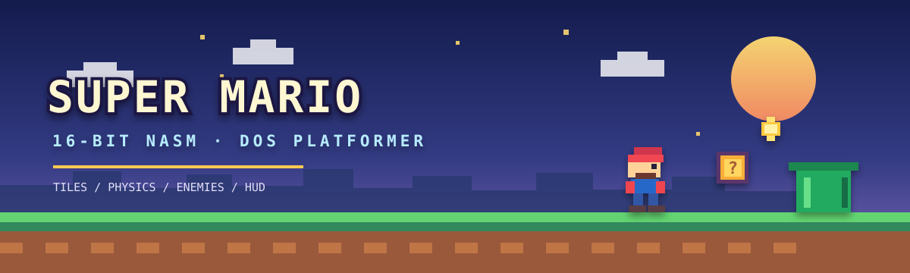
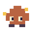
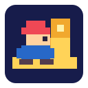

<p align="center">

</p> <h1 align="center">COAL Project · Super Mario</h1>
<p align="center">A beginner-friendly 16-bit x86 assembly platform game built with NASM.</p> <p align="center">
  
  
  
  
</p> <p align="center"><em>Built from the ground up in assembly: movement, tiles, enemies, collision, and HUD.</em></p>

## ✨ What’s inside

|  | Feature | What it does |
| --- | --- | --- |
|  | **Platforming** | Arrow-key movement, run, jumping, and tile-based collisions |
|  | **World** | Scrolling level with pipes, blocks, coins, platforms, and a flagpole |
|  | **Actors** | Enemies, shells, and mushroom power-ups |
|  | **Game systems** | Score, coins, lives, health, timer, high score, pause, win, and game-over states |

## 🧰 Requirements

- **NASM** assembler. The project archive includes `nasm.exe` for Windows; you can also use an installed NASM command.

- **DOSBox** (recommended) or another DOS-compatible environment to run the `.COM` program.

## 🏗️ Build

Run these commands from the project folder—the directory containing `mario.asm` and the `.INC` files.

**Windows, using the included assembler:**

```
nasm.exe -f bin mario.asm -o MARIO.COM
```

**If NASM is installed on your PATH:**

```
nasm -f bin mario.asm -o MARIO.COM
```

The source uses `ORG 100h` and includes the other `.INC` modules from the same folder. A successful assembly creates `MARIO.COM` in the project folder.

## ▶️ Run with DOSBox

1. Start DOSBox.

1. Mount the project folder as drive C (replace the example path with its actual location):

   ```
   mount c C:\path\to\COAL_Project
   c:
   ```

1. If needed, build inside DOSBox with the bundled assembler:

   ```
   NASM.EXE -f bin MARIO.ASM -o MARIO.COM
   ```

1. Run the game:

   ```
   MARIO.COM
   ```

Keep all source modules together. The game saves its high score as `HIGHSCOR.DAT` in the current DOS working directory when it can create that file.

## 🎮 Controls

| Key | Action |
| --- | --- |
| ← / → | Move |
| Left or Right Shift | Run |
| Space | Jump |
| P | Pause / resume |
| Esc during play or pause | Return to title screen |
| ↑ / ↓ on title screen | Select a menu option |
| Enter on title screen | Confirm selection |
| Esc on title screen | Exit |

<details>
<summary>Developer test shortcuts</summary>

- **T** sets the remaining time to 5 seconds.

- **C** sets the coin count to 99.

</details>

## 🗂️ Source files

<details>
<summary>Open the module guide</summary>

| File | Role |
| --- | --- |
| `mario.asm` | Program entry, module includes, main loop, and shutdown |
| `CONSTANT.INC` | Shared game-state and entity constants |
| `VIDEO.INC` | Video mode and palette setup |
| `DRAW.INC` | Drawing helpers and sprite-rendering primitives |
| `LEVEL.INC` | Tile map, tile/sprite data, map drawing, and tile lookup |
| `RENDER.INC` | Gameplay frames, actors, Mario, and HUD |
| `SCREENS.INC` | Title and other screen drawing/text support |
| `INPUT.INC` | Keyboard interrupt handler and key-state table |
| `TIMER.INC` | Timer interrupt and game clock |
| `MOVEMENT.INC` | Mario movement, jumping, collision, and camera logic |
| `ITEMS.INC` | Collectible items, blocks, and mushroom behavior |
| `ENEMIES.INC` | Enemy and shell behavior |
| `GAME.INC` | Game states, menus, pause, death, and win logic |
| `CONTACTS.INC` | Contact rules between Mario and game entities |
| `SCORE.INC` | Score and coin updates |
| `HiSCORE.INC` | High-score loading and saving |

</details>

## 📝 Notes

- The archive includes a prebuilt `MARIO.COM`; rebuild it after editing source files.

- `BUILD.bat` and a DOSBox configuration file are not included, so use the manual commands above.

- This is an educational assembly project. DOSBox behavior may vary with emulator settings and host performance.

<p align="center">

    
<sub>Made with NASM · DOS · a lot of pixels</sub>
</p>
